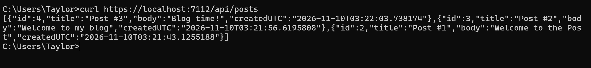

# ApiDemo

This repository extends from my previous BlogWithEf project that I have made. For this one we have added `GET /api/posts` and `POST /api/posts` routes to allow our website to fetch and add posts through an API service.

# How to run

After building, just simply run `ApiDemo.exe` in the directory the build result is stored in.

# Screenshots

